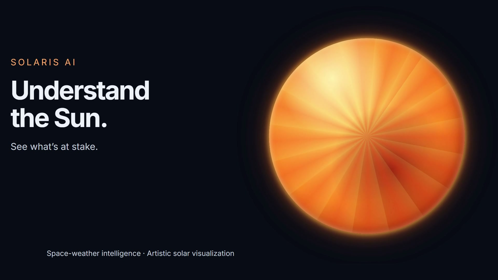
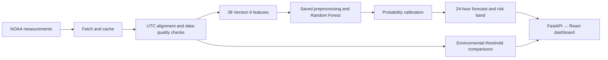

# Solaris AI ☀️

### Solar intelligence. Earthly impact.

**Understand the Sun. See what’s at stake.** Solaris AI turns solar measurements into an understandable view of space weather: what is happening now, how likely a strong flare may be in the next 24 hours, and which connected services could be affected.

Built for students, researchers and curious explorers, it combines **live monitoring, calibrated machine learning and measurement-based impact indicators** in a local dashboard. It helps people investigate risk and uncertainty; it does not predict exact satellite failures or control critical infrastructure.

## Watch the demo

[](docs/demo/solaris-ai-demo.mp4)

**[▶ Watch / download the 10-second MP4](docs/demo/solaris-ai-demo.mp4)** · 1080p · Actual application screens

The video is a recorded snapshot from 4 November 2026. Displayed measurements and forecasts were captured from the running application; they are not current readings when you replay the video. The animated Sun is an artistic illustration. This user-selected edit is approximately 10 seconds long. The original video was made locally with [brag](https://github.com/latent-spaces/brag) and Hyperframes. [Media credits](docs/demo/CREDITS.md).

## What you can explore

| Page | What it helps you understand |
| --- | --- |
| **Overview** | Why solar activity matters to a world connected by satellites and electrical systems. |
| **Solar activity** | Current X-ray class and flux, interactive history, and an experimental 24-hour M/X-class flare probability. |
| **Impact** | Possible effects on HF radio, GPS/navigation, power grids, undersea communications and spacecraft environments. |
| **Alerts** | Recent issued watches, warnings, alerts and summaries. An issued bulletin is not necessarily still active. |
| **Guide** | Scientific terminology, NOAA R/G/S scales, threshold effects, data sources and Version 6 model details. |

The interface includes light/dark modes, a collapsible sidebar, responsive cards, solar animations and reduced-motion support. Missing or stale measurements are labelled; no random values are substituted for unavailable data.

## Run locally on Windows

### Requirements

- **Python 3.10–3.13**; the commands below use Python 3.13.
- **Node.js 20.19+ or 22.12+** and npm.
- Internet access to NOAA for current conditions. CelesTrak is used by the optional orbital-data backend integration.
- The trusted V6 model and supporting artifacts in `backend/models/`, included in this repository.

### 1. Get the project and install dependencies

Run in **PowerShell**:

```powershell
git clone https://github.com/Nikhila-Dhevi-R/Solaris-AI.git
Set-Location Solaris-AI
py -3.13 -m venv .venv
.\.venv\Scripts\python.exe -m pip install -r backend\requirements.txt
npm ci --prefix frontend
```

No API key is required for the public feeds. The default frontend uses Vite’s `/api` proxy. Optional configuration is documented in [.env.example](.env.example); copy it to `frontend/.env` only if you need a custom API base URL.

### 2. Start the backend

```powershell
.\.venv\Scripts\python.exe -m uvicorn app:app --app-dir backend --host 127.0.0.1 --port 8000
```

### 3. Start the frontend in a second terminal

From the same project directory:

```powershell
npm run dev --prefix frontend
```

Open **http://127.0.0.1:5173/**. Interactive API documentation is at **http://127.0.0.1:8000/docs**. Keep both terminals running; press `Ctrl+C` to stop each service. This project runs locally and requires no hosting or deployment.

## How it works



**Measured conditions** come from NOAA SWPC GOES X-ray and proton observations and planetary Kp. Current observations and history are cached for two minutes; Kp, protons and alert products use five-minute caches. Orbital elements use a one-hour cache and are returned by the backend; an orbital-elements card is not displayed.

**Forecasts** use completed-hour bins and trailing windows. The live adapter requires fresh observations, a single identified satellite and at least 80% usable coverage in both X-ray channels over 1-, 24- and 72-hour windows. The saved preprocessing pipeline and probability calibrator are applied during inference. Inputs with excessive missing features or invalid coverage are rejected.

**Impact indicators** compare measurements against environmental scales. They describe possible effects, not observed service outages. HF indicators reflect X-ray-driven sunlit-side conditions; navigation and power-grid indicators use global Kp context. Local GPS error, transformer current, cable damage and satellite failure probabilities require additional information and are not calculated.

## The frozen Version 6 model

| Property | Value |
| --- | --- |
| Artifact | `backend/models/solaris_ai_random_forest_phase2.joblib` |
| Estimator | Random Forest with saved preprocessing and probability calibrator |
| Inputs | Exactly 38 features, validated against the supplied schema |
| Target | M/X-class flare occurrence over a 24-hour horizon |
| Forecast alert cutoff | `0.20594365951619512` |
| Low → Moderate boundary | `0.02756797277329327` |
| Moderate → High boundary | `0.36999108243721823` |
| Runtime | scikit-learn **1.6.1** |

The loader verifies the artifact’s SHA-256, feature order, estimator type and frozen thresholds. The supplied model is used without retraining. Load only trusted joblib artifacts: their serialization can execute Python code.

### Historical evaluation — not a live accuracy promise

The supplied descriptive 2020–2024 test table reports **79.21% accuracy**, **88.13% recall**, **59.99% precision**, and **0.901 ROC AUC** at the frozen alert cutoff. These describe hourly forecast windows, not independently counted flare events. Results vary by year; test data had previously been observed.

**All forecasts remain experimental informational shadow outputs.** Operational NOAA feeds lack the science-quality flags used in training. Live feature equivalence, probability calibration under current conditions and operational reliability have not been established. A risk band is not a guarantee, and a flare probability alone cannot establish spacecraft impacts.

## API

| Method | Endpoint | Response |
| --- | --- | --- |
| GET | `/api/health` | Service health |
| GET | `/api/conditions` | Current X-ray flux, class, timestamp and freshness |
| GET | `/api/history?hours=24` | Flux history; accepts 1–168 hours |
| GET | `/api/forecast` | Experimental live-input forecast or a reason it is unavailable |
| POST | `/api/forecast/features` | Inference from exactly 38 caller-supplied named features |
| GET | `/api/satellites` | Service and spacecraft environmental indicators, measurements and optional orbital elements |
| GET | `/api/alerts` | Recent issued space-weather bulletins |
| GET | `/api/model` | Verified V6 metadata, cutoffs and historical evaluation |

The feature-input endpoint accepts `{"features": {"feature_name": 0.0}}` as a shape illustration only: supply **all 38 exact names** from the schema. It cannot independently verify a caller’s data provenance or quality. All displayed timestamps use UTC.

## Project structure

```text
backend/
  app.py                 API, source retrieval and caching
  features.py            Science-quality feature transformation
  realtime.py            Operational-feed feature adapter
  inference.py           Input checks and calibrated inference
  model_service.py       Verified artifact loading and model details
  impacts.py             Measurement-based environmental assessments
  models/                V6 model, schema and evaluation artifacts
  tests/                 Backend regression tests
frontend/
  src/                   React pages, charts, guide and themes
  tests/                 Threshold, freshness and glossary tests
docs/demo/               Video demo, poster and credits
.env.example             Optional local configuration
```

## Test and build

```powershell
$env:PYTHONPATH='backend'
.\.venv\Scripts\python.exe -m pytest backend\tests -q
npm test --prefix frontend
npm run build --prefix frontend
```

Latest executed application checks: **20 backend tests passed**, **6 frontend tests passed**, and **Vite build passed**. The build reports a JavaScript chunk above 500 kB; backend tests emit a Starlette/httpx deprecation warning. These focused checks do not establish operational forecast accuracy. No GitHub CI workflow is currently configured.

## Troubleshooting

- **Page does not open:** keep the frontend terminal running and use the URL Vite prints. Check that port 5173 is available.
- **API unavailable:** confirm the backend is running on port 8000 and open `/api/health`.
- **Forecast unavailable:** inspect its reason in Guide or the API response. Feed failures, stale observations and insufficient coverage can correctly block inference.
- **Model verification fails:** restore the trusted V6 artifact and install the pinned requirements. Do not substitute a different model to bypass the checks.
- **Feed temporarily unavailable:** retry Refresh after a short interval. External data can be delayed, revised or missing.

## Sources and scientific scope

- [NOAA SWPC space-weather scales](https://www.swpc.noaa.gov/noaa-scales-explanation)
- [NOAA public data service](https://services.swpc.noaa.gov/)
- [CelesTrak orbital-data format](https://celestrak.org/NORAD/documentation/gp-data-formats.php)
- [USGS: geomagnetic induction in submarine cables](https://www.usgs.gov/publications/modeling-geomagnetic-induction-submarine-cables)

Solaris AI is built for research, education and situational awareness. Use authoritative operational products and mission-specific procedures for safety-critical decisions. It issues no autonomous commands.
